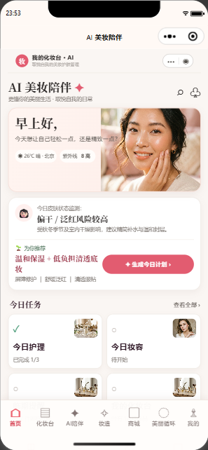
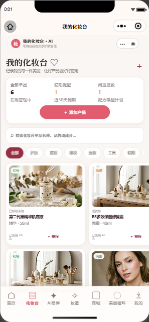
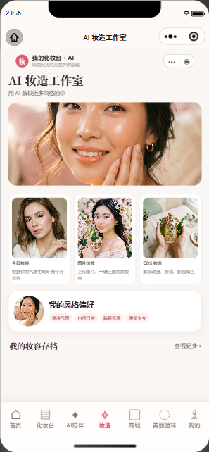
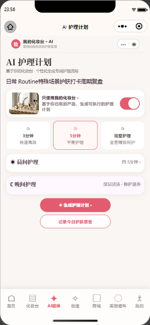

<div align="center">

# Beauty Twin AI

### 个人化妆台 × 成分护肤 × AI 妆造工作室

把“拍照识别产品、理解成分、生成妆容、照着跟练”收进同一条体验链路。

[](https://beauty-twin-ai.lumen-7b2.workers.dev/)
[](https://react.dev/)
[](https://www.typescriptlang.org/)
[](https://developers.cloudflare.com/workers/)

<br />


</div>

<div align="center">



</div>

<div align="center">

<a href="https://github.com/JiuChen-yume"></a>
<a href="https://github.com/JiuChen-yume"></a>

</div>

<p align="center"><sub>上方卡片使用 GitHub Readme Stats 动态生成，统计数据以 GitHub 公开仓库为准。</sub></p>

## 这是什么

Beauty Twin AI 是一个面向个人用户的美妆与护肤工作台。它将用户的化妆台、肤质档案、产品成分资料、AI 妆造和跟练流程连接起来，让一次拍照可以继续产生可执行的下一步：确认产品、检查搭配、生成妆容、按步骤练习并保存结果。

项目采用 React/Vite 前端，并同时提供本地 Express API 与 Cloudflare Workers 部署入口。前端始终通过同源 `/api` 调用服务，方便在本地、Workers 和未来的小程序端复用业务层。

## 体验主线

```text
上传产品 / 自拍
        ↓
腾讯云 OCR、商品识别、二维码识别
        ↓
豆包视觉理解 + 产品资料检索
        ↓
个人化妆台 / 成分兼容性 / 护肤计划
        ↓
日常妆、图片仿妆或 COS 妆造
        ↓
Seedream 妆效图 + 分步骤参考图
        ↓
跟练、复核、存档
```

## 核心能力

| 模块 | 当前能力 |
| --- | --- |
| 我的化妆台 | 手动录入、拍照识别、批量导入、条码/二维码识别、用户确认后入柜 |
| 产品资料 | 通过服务端 AI 与公开来源补充主要成分、注意事项和评价摘要，并保留来源与待核验状态 |
| 护肤计划 | 根据肤况、时间预算和化妆台产品生成早晚流程，支持“加入今日计划”同步 |
| 成分安全 | 两个或多个产品的成分兼容性检查、冲突解释和使用顺序建议 |
| AI 妆造 | 今日日常妆、图片仿妆、角色 COS；参考图和角色信息会进入生成提示 |
| 虚拟试妆 | Seedream 妆效图、按跟练步骤生成的局部参考图、原图对比和导出 |
| 跟练工作台 | 结构化步骤、目标区域、产品、工具、用量、避坑提示、自检清单和进度保存 |
| Cloudflare | Workers API、Workers Assets、D1 产品/计划数据、R2 图片资源 |

## 预览

<div align="center">





</div>

## 技术架构

```text
React + Vite
├─ src/components/screens      页面与业务交互
├─ src/components/makeup       试妆编辑器与跟练工作台
├─ src/services                识别、成分补充、试妆适配层
├─ src/types                   产品、计划、妆容与认证模型
└─ server.ts / cloudflare/
   ├─ 本地 Express API
   └─ Cloudflare Worker API
      ├─ Tencent Cloud OCR / DetectProduct / QrcodeOCR
      ├─ Doubao Vision / Seedream
      ├─ Gemini / DeepSeek 文本兜底
      ├─ Tavily 公开资料搜索
      └─ D1 / R2 / Workers Assets
```

## 本地运行

需要 Node.js 18 或更高版本。

```bash
npm install
npm run dev
```

打开 <http://localhost:3000>。

常用校验命令：

```bash
npm run lint
npm run build
```

没有配置 AI Key 时，页面仍可以启动并展示本地状态；真实识别、资料搜索和生图能力会根据服务端配置显示为可用或待配置。

## 环境变量

先复制 `.env.example` 为 `.env`。密钥只放在服务端或 Cloudflare Worker Secret 中，不能写入 `VITE_` 前缀变量，也不要提交 `.env`。

| 变量 | 用途 | 必需 |
| --- | --- | --- |
| `TENCENTCLOUD_SECRET_ID` / `TENCENTCLOUD_SECRET_KEY` | 腾讯云 OCR、商品、二维码/条码识别 | 按需 |
| `DOUBAO_API_KEY` / `VOLCENGINE_ARK_ENDPOINT` | 豆包视觉和文本理解 | 按需 |
| `VOLCENGINE_IMAGE_API_KEY` / `VOLCENGINE_IMAGE_MODEL` | Seedream 妆效图和分步参考图 | 生成图时 |
| `VOLCENGINE_IMAGE_ENDPOINT` | 可填完整 URL 或 Endpoint ID；服务会自动解析为 Ark 图片生成接口 | 生成图时 |
| `TAVILY_API_KEY` | 搜索公开产品资料与评价来源 | 产品补充时 |
| `GEMINI_API_KEY` / `DEEPSEEK_API_KEY` | 文本生成与备用分析 | 按需 |
| `WEBAR_APP_ID` / `WEBAR_LICENSE_KEY` / `WEBAR_TOKEN` | 腾讯 WebAR 妆效适配器 | WebAR 时 |

完整的接口、请求体、服务职责和 Cloudflare 配置见 [docs/API-TECHNICAL.md](docs/API-TECHNICAL.md)。

## 主要 API

| 场景 | API |
| --- | --- |
| 产品识别 | `POST /api/product/recognize`、`POST /api/ocr/recognize`、`POST /api/barcode/recognize` |
| 产品资料补充 | `POST /api/products/enrich` |
| 成分分析 | `POST /api/compatibility/check` |
| 妆容方案 | `POST /api/makeup/generate`、`POST /api/makeup/parse-tutorial` |
| 妆效图 | `POST /api/makeup/render`、`POST /api/makeup/render-layer` |
| 产品与计划 | `GET/POST /api/products`、`POST /api/products/sync`、`POST /api/routine/today-products` |
| 图片与头像 | `POST /api/uploads`、`POST /api/avatar/generate` |

## Cloudflare 部署

项目已经提供 `wrangler.jsonc`、`cloudflare/worker.ts`、D1 migrations 和 Workers Assets 配置。部署前登录 Cloudflare 并准备 D1：

```bash
npx wrangler login
npx wrangler d1 migrations apply beauty-twin-db --remote
npm run cf:deploy
```

生产环境的 API Key 使用 `wrangler secret put NAME` 写入 Worker。不要把真实密钥写进 README、Issue、截图或提交记录。

## 目录速览

```text
src/components/screens/MakeupScreen.tsx   妆造入口与三种工作流
src/components/makeup/                    试妆编辑器、图层和跟练
src/components/AddProductModal.tsx        录入、批量识别与确认入柜
src/services/productEnrichmentService.ts  产品资料补充客户端入口
server.ts                                  本地 API 与开发兜底
cloudflare/worker.ts                       Workers API 与 D1/R2 适配
docs/API-TECHNICAL.md                      接口和外部服务说明
migrations/                                D1 数据结构迁移
```

## 路线图

- [x] 化妆台与护肤计划的本地业务闭环
- [x] 腾讯云产品、OCR、二维码/条码识别入口
- [x] 豆包视觉与 Seedream 妆效生成适配
- [x] 妆容步骤和跟练进度模型
- [ ] 为每个真实 SKU 建立已审核的腾讯 WebAR / Seedream 素材映射
- [ ] 完成账号、D1 数据隔离和 R2 用户资源权限
- [ ] 增加真实设备回归测试与 API contract tests

## 参与贡献

欢迎提交 Issue 或 Pull Request。请先阅读 [CONTRIBUTING.md](CONTRIBUTING.md)，并在提交前运行 `npm run lint` 与 `npm run build`。

## License

当前仓库尚未声明开源许可证。未经许可，请不要把项目代码或素材用于商业分发。

<div align="center">

<sub>Built with React, Cloudflare, Tencent Cloud, Doubao and a lot of makeup notes.</sub>

</div>
